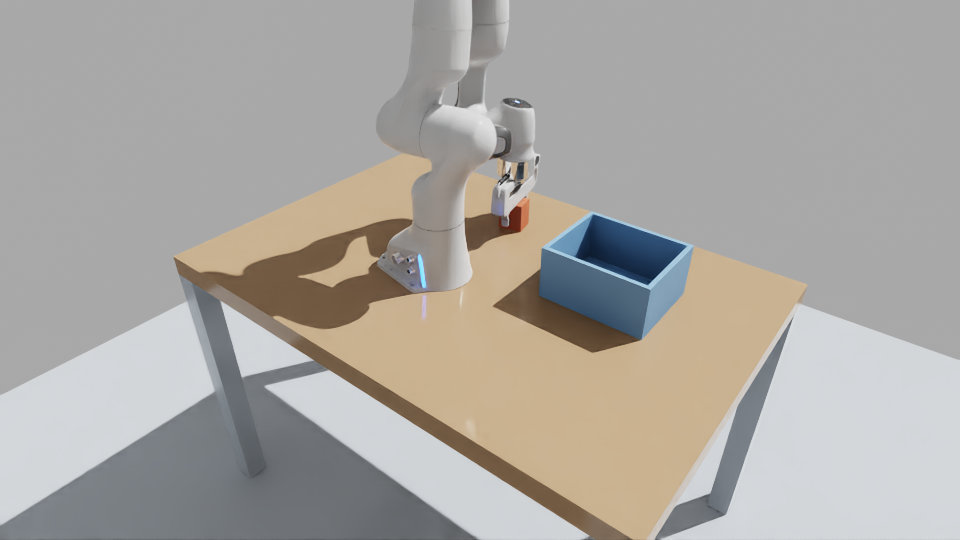
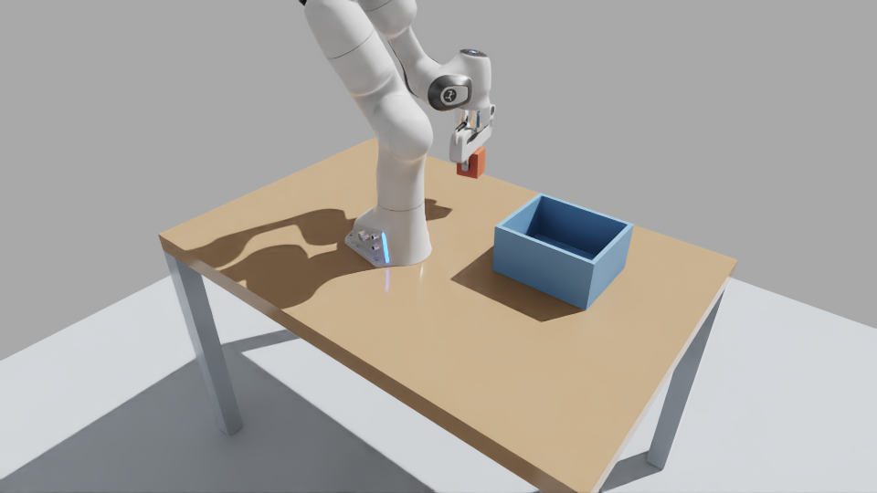
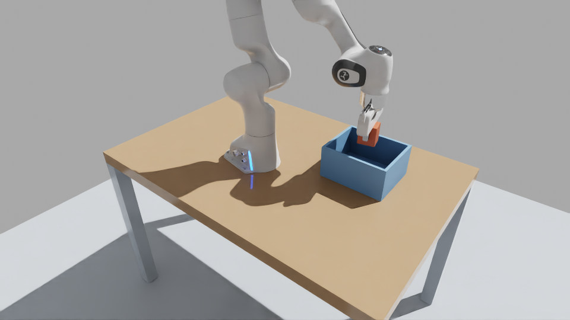
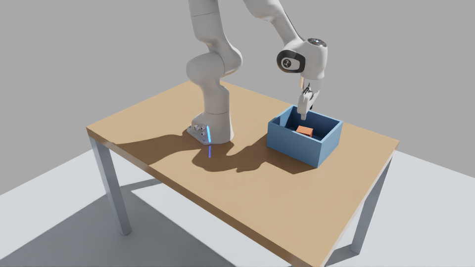
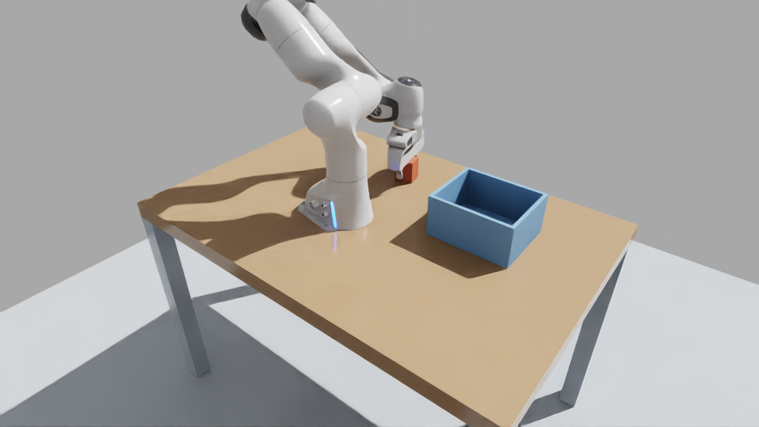
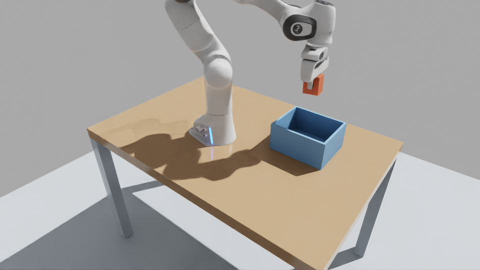
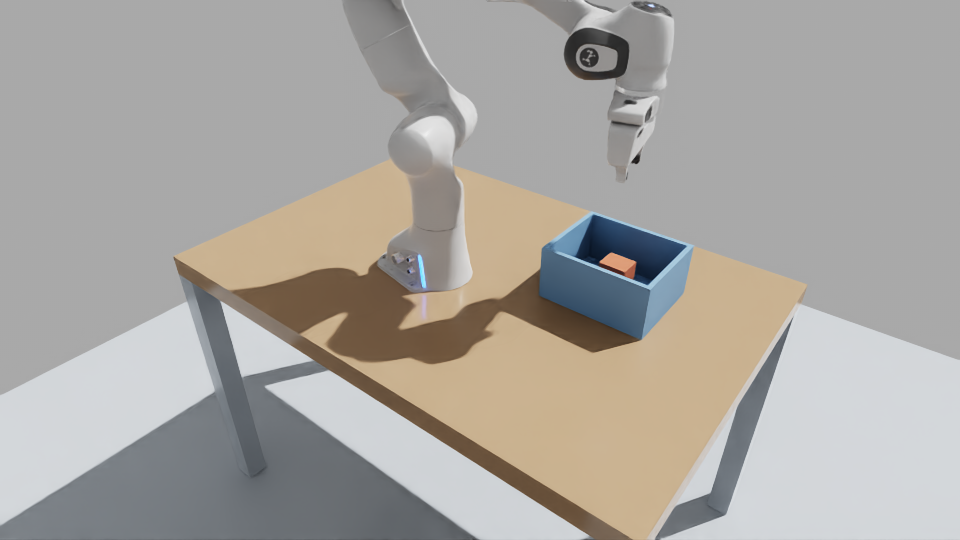

# Franka Tabletop Pick-and-Place Environment

Isaac Sim 5.1 / PhysX environment for Franka Panda tabletop pick-and-place with **cuRobo v0.7.6 MotionGen** motion planning and a PickPlaceController baseline.

Both backends produce `success: true` with real PhysX two-finger contact — no suction, no teleportation.

## Demo: cuRobo MotionGen Pick-and-Place

<p align="center">
  
  
</p>
<p align="center">
  
  
</p>
<p align="center"><i>cuRobo MotionGen: approach → grasp → transfer → place in bin (Isaac Sim / PhysX)</i></p>

## cuRobo MotionGen Backend

The cuRobo backend (`src/geniesim_features/execution/curobo_backend.py`) uses [NVIDIA cuRobo v0.7.6](https://github.com/NVlabs/curobo) for GPU-accelerated motion planning with collision-aware trajectory generation.

### Planning Pipeline

The pick-and-place task is decomposed into 6 planned phases, each solved by `MotionGen.plan_single()`:

| Phase | Description |
|-------|-------------|
| **approach** | Move end-effector above the object with gripper open |
| **descend** | Lower vertically onto the block (FK corridor check rejects lateral detours) |
| **clearance** | Close gripper — PhysX two-finger contact only, no suction |
| **lift** | Lift block straight up off the table |
| **transfer** | Move horizontally to above the bin opening |
| **lower** | Descend into bin and release |

Key design choices:
- Descent trajectory uses FK lateral corridor detection to prevent the gripper from sweeping sideways and knocking the block
- Grasp relies solely on PhysX finger contact; after lift-off, the block's collision geometry is added to cuRobo's world model to prevent re-planning through the held object
- The gripper aligns to the block's actual settled yaw (~11.8 deg) measured from PhysX, not a fixed angle
- All 6 phases produce real joint trajectories applied via `ArticulationController`

### Running cuRobo

**Prerequisites:** cuRobo v0.7.6 source, Torch CUDA, Ninja compiler.

```bash
cd /path/to/franka_tabletop_env
export DISPLAY=:20  # for GUI; omit for headless
export PATH=/isaac-sim/kit/python/bin:$PATH
export LD_LIBRARY_PATH=/isaac-sim/exts/omni.isaac.ml_archive/pip_prebundle/torch/lib:$LD_LIBRARY_PATH
export PYTHONPATH=src:/path/to/curobo076/src
export TORCH_CUDA_ARCH_LIST=8.9  # adjust for your GPU

# Run with GUI
/isaac-sim/python.sh -m geniesim_features franka-demonstrate \
  --scene scene_original \
  --config config/sensors/franka_fixed.yaml \
  --task config/tasks/franka_motiongen.yaml \
  --output evidence/curobo_run \
  --gui --physics-hz 60 --control-hz 60

# Or headless
/isaac-sim/python.sh -m geniesim_features franka-demonstrate \
  --scene scene_original \
  --config config/sensors/franka_fixed.yaml \
  --task config/tasks/franka_motiongen.yaml \
  --output evidence/curobo_run \
  --headless --physics-hz 60 --control-hz 60
```

### cuRobo Results

| Metric | Value |
|--------|-------|
| Planning phases | approach → descend → clearance → lift → transfer → lower |
| Actions / Observations | 1426 / 1427 |
| Two-finger contact frames | 650 |
| Held lift frames | 407 |
| Max lift | 0.195m |
| Grip slip | 0.07mm |
| Object settled in bin | Yes |

## PickPlaceController Baseline

The built-in Isaac Sim `PickPlaceController` serves as a reference baseline.

<p align="center">
  
  
  
</p>
<p align="center"><i>PickPlaceController: grip → carry → settle</i></p>

```bash
/isaac-sim/python.sh run.py \
  --scene scene_original \
  --output episode.json \
  --capture
```

| Metric | Value |
|--------|-------|
| Two-finger contact frames | 849 |
| Held lift frames | 497 |
| Max lift | 0.265m |
| Grip slip | 2.51mm |
| Object settled in bin | Yes |

## Repository Structure

```
run.py                           PickPlaceController standalone baseline
visual.py                        GUI visualization runner
launch.ps1                       Windows PowerShell remote launcher
scene_original/                  Original USD scene (table 0.75m, block 60x50x70mm)
config/
  tasks/                         franka_pick_place.yaml, franka_motiongen.yaml
  sensors/                       Camera and observation config
  batches/                       Batch experiment definitions
  randomization/                 Domain randomization config
src/geniesim_features/
  franka_runtime.py              Franka runtime orchestrator
  execution/
    franka_backend.py            PickPlaceController backend
    curobo_backend.py            cuRobo MotionGen backend
  manipulation/                  Trajectory planning, geometry, executor
  adapters/
    curobo_planner.py            cuRobo MotionGen wrapper
    isaac_world.py               Isaac Sim world interface
    isaac_sensors.py             Sensor adapters
  recording/                     Episode recording and replay
  scene_generation/              USD scene builder, layout, assets
evidence/                        Verified results and phase images
experiments/curobo/              cuRobo smoke tests and diagnostics
```

## Success Criteria

| Metric | Requirement |
|--------|-------------|
| Two-finger contact | Both fingers contact the block simultaneously |
| Sustained grip | >= 10 consecutive frames of dual contact |
| Lift height | > 50mm above table surface |
| Grip slip | <= 35mm relative displacement during transport |
| Release position | Entire rotated bounding box inside bin opening (3mm margin) |
| Release speed | <= 0.3 m/s |
| Settled in bin | Object inside bin cavity, < 5mm drift over final 30 frames |

`controller_done` alone does NOT constitute success.

## Remote Launch (from Windows)

```powershell
.\launch.ps1 -Server 'user@host' -Port 22 `
  -RemoteDirectory '/path/to/franka_tabletop_env' `
  -IsaacPython '/isaac-sim/python.sh'
```

Add `-Gui` for remote desktop visualization. Results auto-download to `evidence/`.

## Requirements

- **Isaac Sim 5.x** (tested 5.1.0)
- Python 3.11+, NumPy, PyYAML, Pillow
- **cuRobo v0.7.6** + Torch CUDA + Ninja (for MotionGen backend)

## Notes

- The scene block has ~11.8 deg yaw after settling; gripper alignment accounts for this
- `scene_original/` is used as-is from the upstream project; the blue bin is not moved
- G2 robot adapters are preserved for reference but Franka uses independent backends
- Full episode archives (`full_episode.tar.zst`) are kept locally, not in Git
